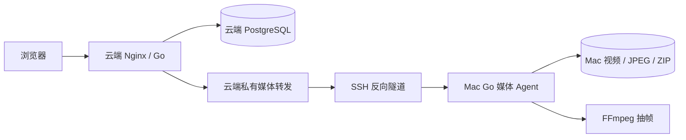

# P0.1 Mac 媒体存储、接口与运行边界

执行说明：用户已暂停P0.1。本文0.2.0修订稿与四来源规格一并待审核；不得因收到Mac状态而恢复编码/隧道/部署。

版本：0.2.0｜状态：暂停后的修订稿，待审核，未实施｜日期：2026-10-13

## 1. 目的与明确职责

本规格用于新增Mac资源的完整人工标注闭环：素材选择或上传/公司导入→Mac抽帧→云端显示与保存→Mac打包→浏览器下载。只接通SSH或代理一张图片不足以交付。

来源统一见[四入口规格](sources-and-samples.md)：公共示例由local适配器在云端执行，Mac素材/本地上传/公司接口媒体由Mac处理。provider按每条资源决定，不设置关闭公司入口的全局Mac模式。

| 数据/工作 | 权威位置/责任方 | 云端是否允许落盘 |
| --- | --- | --- |
| 新 Mac 原视频、抽帧 JPEG、缩略图 | Mac 不可变媒体目录 | 不允许 |
| 新 Mac 暂存上传、FFmpeg 输出、ZIP | Mac 专用暂存目录 | 不允许 |
| 标注框、revision、完成状态、业务 job | 云端 PostgreSQL，由 Go 管理 | 允许；这是业务元数据 |
| Mac 操作 manifest/幂等记录 | Mac 文件 manifest，仅执行状态与资源清单 | 不作为第二业务数据库，不含标注权威状态 |
| COCO 语义、已完成帧选择与快照 | 云端 Go | 元数据可持久化；不含图片 bytes |
| 新公开样例的视频/JPEG/ZIP | 云端local媒体适配器与公开样例卷 | 允许；这是云端常驻演示数据 |
| 已有 P0 local 视频/帧/ZIP | 原云端媒体适配器与原卷 | 兼容保留，不纳入“新增 Mac 媒体无云端文件”的结论 |
| 浏览器下载包/当前图片 | 使用者浏览器 | 用户下载可写本机；与云端无媒体文件区分 |

不宣称整个平台没有磁盘写入：PostgreSQL、普通安全运维日志、旧媒体都有合法持久化。验收结论限定为：**新增 Mac 媒体 payload 不进入云端普通文件、缓存、临时 ZIP、日志、swap 或 core dump。** 只有完成部署检查才能宣称该范围通过，纸面选项不算证据。

## 2. 拓扑与连接

- Mac主动连云端专用classroom-tunnel，仅允许远程监听云端127.0.0.1:19090。现有Mac只读媒体服务127.0.0.1:19090保留；新增项目Go媒体执行端默认127.0.0.1:19092，避免抢占/覆盖原服务。隧道映射云端19090→Mac19092，执行端从本机19090服务按已核对的契约读取授权素材。
- Go 容器经实际 Docker 网络的私有网关地址访问云端转发服务；不硬编码 Docker 子网，不把转发端口绑定 `0.0.0.0`。端口和媒体地址以外部配置传入。
- 云端 Go 调用 Agent 使用专用随机 Bearer Token；不复用演示网页密码、公司 API Key 或 SSH 私钥。Token 由外部文件配置，Mac/云端各自读取；不得出现于 URL、日志、Git 或浏览器。
- 对外页面/API/媒体仍经过现有门禁；前端不直连 Mac、私有代理地址或 SSH 端口。
- 原候选代理只有 GET/HEAD，不支持命令与上传，**不能原样复用**。P0.1 转发将按 `/bridge/v1/media/` 读取与明确的控制路由分别白名单，默认路径拒绝。
- 专用账号拒绝 shell/TTY/本地转发/任意监听；host key 必须来自已核验管理连接，Mac 自行固定 known_hosts，不能盲信 ssh-keyscan。

Mac本地已有服务先保留；项目交付同仓库Go媒体执行边界，先核对真实接口再适配或增加所需能力，不把当前v1接口假定为完整bridge契约，也不直接覆盖原服务。

用户转交的Mac侧检查：在线arm64，FFmpeg7.1已完整解码授权视频但不在默认PATH；默认PATH未发现ffprobe；127.0.0.1:19090本地健康/认证/列表200，9个媒体hash和HEAD200/no-store匹配；只有路径v1、没有contractVersion；云端隧道未验证。这是Mac侧报告，不是Windows云端实测。恢复后须核对媒体类型，不能把9个媒体当9段视频。

配置键固定如下；路径/地址由环境决定，不能写死在源码或测试fixture：

| 配置 | 默认/要求 |
| --- | --- |
| `APP_SAMPLE_CATALOG_FILE` / `APP_SAMPLE_MEDIA_ROOT` | 版本化公开登记清单/源码外媒体根；样例固定local，不接受任意下载URL |
| `APP_MAC_BRIDGE_URL` | Mac三类入口启用时必填，仅授权私有origin；请求体不得覆盖origin |
| `APP_MAC_BRIDGE_TOKEN_FILE` | Mac三类入口启用时必填，源码外受限文件；不打印内容 |
| `MAC_AGENT_ADDR` | 默认127.0.0.1:19092，仅loopback，不抢占现有19090 |
| `MAC_SOURCE_SERVICE_URL` / `MAC_SOURCE_TOKEN_FILE` | 默认本机127.0.0.1:19090的已存在只读服务；精确核对字段/鉴权，不复用桥接Token |
| `MAC_MEDIA_ROOT` / `MAC_TOKEN_FILE` | 必填、源码外绝对路径；Token权限核验 |
| `MAC_FFMPEG` / `MAC_FFPROBE` | 实际可执行文件路径，启动检查 |
| `MAC_DATASET_API_URL` / `MAC_DATASET_ID` / `MAC_DATASET_API_KEY_FILE` | 公司接口仅在Mac配置，Key放外部文件；未配置不影响公共示例/授权素材 |
| `MAC_OPERATION_LEASE_SECONDS` / `MAC_QUEUE_SIZE` | 默认120/8，正值且能力响应一致 |
| `MAC_MAX_UPLOAD_BYTES` / `MAC_MAX_FRAMES` | 默认1GiB/1000，与云端配置核对 |
| `MAC_ARCHIVE_TTL_SECONDS` | 默认3600，仅清理到期export资源 |
| `APP_MEDIA_DOWNLOAD_TIMEOUT_SECONDS` | 默认1800，独立于普通API超时 |

launchd配置模板只引用外部配置文件，不嵌入Token/私钥。云端转发地址根据实际Docker网关生成，部署记录生成结果但公开日志脱敏。

## 3. 三模块与实现边界

保留 frontend/backend/ai-service。新增 `backend/cmd/media-agent/` 启动入口，与业务 server 使用同一 Go 模块；媒体执行能力在 `backend/internal/mediaagent/`，远端 HTTP 客户端在 `backend/internal/mediabridge/`。

只提取真实重复的 ffprobe、FFmpeg process、抽帧计划、JPEG 校验；Agent 不 import store/annotations，不持有 PostgreSQL 凭证。Mac manifest 是执行幂等和物理资源清单，不另建业务数据库或同步标注库。

业务层只依赖小型明确媒体接口：注册/上传、提交抽帧、查看/取消操作、打开媒体、准备导出。local/mac 两个适配器承担物理差异；handler 不按文件路径猜 provider。不提取通用“万能 storage framework”。

`storage_provider` 与不透明 key 定位媒体；视频/帧 SHA-256、字节长度与尺寸用于身份核验。禁止使用用户输入绝对路径、`../`、任意 URL 或符号链接逃出媒体根；manifest 中的 key 也需校验。镜像图或合成占位图不能冒充原视频抽帧。

## 4. 接口草案与既有服务的区别

下面是拟制定的 **项目桥接 v1 契约**，不是声称已观察到 Mac 当前响应。R0 核对现有服务与运行信息，Leader 冻结本契约后才实现；不能凭猜测描述公司 API。

云端浏览器 API 保持 `/api/v1`，保留上传/抽帧/任务/保存/导出既有语义，新增：

| 入口 | 请求/响应 | 行为 |
| --- | --- | --- |
| `GET /api/v1/media-sources/mac` | cursor分页，items含sourceId/mediaKind/name/dimensions/durationSeconds/hash/sizeBytes，nextCursor | 授权素材清单，不返回物理路径；仅video可用于抽帧 |
| `POST /api/v1/media-sources/mac/imports` | `{sourceId}` / 202 既有 Job | 注册 Mac 已存在媒体，仅保存元数据引用 |
| `GET /api/v1/media-storage/status` | providers/sourceKinds分别的available/reasonCode | 不返回秘密；local/mac/dataset配置与DB ready分开 |
| `POST /api/v1/videos` | 既有multipart file / 201 Video | 本地上传固定流式转交Mac；云端公开样例另走sample入口 |

清单分页固定最大 20 项；`nextCursor` 为不透明值，无下一页为 null。已导入 source 以 provider+sourceId+sha256 防重复；同 key 内容发生变化必须重新登记新身份，不能重写已标注帧。

sourceId由本项目Mac授权登记表生成稳定不透明ID。当前接口只有id，必须先核对含义并形成映射（sourceId→现有媒体身份/校验摘要）；两者字段名不直接互换，也不把catalogFileId或文件名当sourceId。记录跨服务重启保持稳定；未冻结映射不注册真实样本。媒体类型显式分video/image，抽帧入口仅列可解码视频。

登记时在Mac本机将授权源文件复制到Agent受控的不可变媒体目录并核对源清单摘要，不通过云端传输、不使用可能被原路径修改的硬链接。需要计入这份本机副本的磁盘空间；源变化则拒绝登记，不覆盖旧版本。清单只含经授权的登记项，不自动扫描公司网络或整个Mac硬盘。

Mac 仅云端内部访问，响应包含 `contractVersion="1.0.0"`。所有 `/bridge/v1/*` 需 Bearer，独立存活检查只表示进程状态，不证明媒体/隧道可用。

| 桥接入口 | 字段与结果 | 规则 |
| --- | --- | --- |
| `GET /bridge/v1/capabilities` | `{contractVersion,agentVersion,mediaRootWritable,ffmpegAvailable,maxUploadBytes,maxFrames}` | 发布前版本、能力、上限必须匹配 |
| `GET /bridge/v1/sources?cursor=…` | 同云端素材分页形状 | 只列明确授权的素材登记表 |
| `POST /bridge/v1/registrations` | `{operationId,videoId,sourceId}` / `{operationId,videoId,mediaKey,sha256,sizeBytes,width,height,durationSeconds}` | 登记已存在视频；幂等 |
| `GET /bridge/v1/dataset/lessons` | P0页参数 / 已观察的安全列表DTO | Mac调用公司API，不回传Key/签名URL |
| `POST /bridge/v1/dataset/imports` | operationId/jobId/videoId/catalogFileId/name / 202操作 | Mac查询play-url并下载/探测/准备，云端Go发布业务记录 |
| `POST /bridge/v1/uploads` | multipart file，headers `X-Operation-ID` / `X-Video-ID`；返回同 registration | 逐块写 Mac staging，完整 probe 后原子发布；断流拒绝 |
| `POST /bridge/v1/extractions` | `{operationId,jobId,batchId,videoId,mediaKey,timestampsMs,deadlineSeconds}` / 202 `{operationId,status}` | 只接受 Go 已校验的有限时间戳计划 |
| `GET /bridge/v1/operations/{operationId}` | `{operationId,status,progress,errorCode,manifest?}` | manifest 为完整批次，不暴露部分帧 |
| `POST /bridge/v1/operations/{operationId}/renew` | 空对象 / 200 | 仅延长运行操作租约，不改变业务终态 |
| `POST /bridge/v1/operations/{operationId}/cancel` | 空对象 / 200 `{operationId,status}` | 真正停止 FFmpeg、清理后才 cancelled |
| `POST /bridge/v1/operations/{operationId}/ack` | `{jobId}` / 200 | 云端事务发布成功后确认；不把 ack 等同于 DB 权威 |
| `POST /bridge/v1/archives` | `{operationId,images:[{frameId,mediaKey,sha256,sizeBytes,width,height}],coco}` / 202 `{operationId,status}` | Go 提供已完成帧快照和 COCO，Mac 检查并完整打包 |
| `GET/HEAD /bridge/v1/media/{mediaKey}` | 视频/图片/ZIP bytes + Content-Length/Content-Type/ETag | 不透明 key，仅登记资源；单 Range 支持 206/416 |

operationId/jobId/batchId/videoId/frameId 用现有稳定随机 ID；key 不允许斜杠/路径分隔符。帧 manifest 为 `{batchId,frames:[{frameId,timestampMs,width,height,mediaKey,sha256,sizeBytes}]}`；archive manifest 为 `{mediaKey,sha256,sizeBytes,expiresAt}`。所有数字必须有限且在限额内。

operation/status不返回bridge Token或原始请求。云端Video增量返回sourceKind与storageProvider，Frame保留既有imageUrl语义；availability从独立storage/status读取，不把内网地址暴露给前端。

桥接执行状态为 queued/running/completed/failed/cancelled；云端 cancelling 由 Go 维护。completed 表示不可变输出已完整准备，不意味着数据库已经发布。错误形状 `{code,message,requestId}`，只含安全枚举：`INVALID_REQUEST/UNAUTHORIZED/RESOURCE_NOT_FOUND/RESOURCE_CHANGED/OPERATION_CONFLICT/QUEUE_FULL/NO_SPACE/PROCESS_FAILED/TIMEOUT/CLEANUP_FAILED`。云端映射到现有错误框架，业务 409 不能被媒体重试掩盖。

控制 JSON 最大 16MiB，超限 413；上传沿用默认 1GiB 上限；每批最多既有配置 `APP_MAX_FRAMES`（当前默认 1000）；单操作 600秒上限、一个 FFmpeg Worker、队列最多 8。export 图片上限沿用 2GiB，超过返回已有 export limit 错误，用户分批导出。

上传/准备操作总超时600秒，下载采用连接5秒、读空闲60秒、总时长1800秒的独立配置，不复用现有30秒普通API客户端。大文件上限不代表在5Mbps演示带宽下一定可及时传完；演示使用小范围素材/帧，超时明确失败，不能静默省略图片。双方限额不匹配时能力检查失败，避免请求做到一半才发现不同上限。

## 5. 幂等、发布与失败恢复

1. Go 先记录 media_operations 与稳定 operationId，再发请求。Mac 以 operationId+请求摘要持久化执行 manifest，相同操作和输入重复提交返回同一结果；相同 ID 不同输入返回 409，不再跑 FFmpeg。
2. Mac 上传/抽帧在 staging 准备，检查尺寸/摘要/完整性，原子 rename 成不可变资源并产生完整 manifest；准备中的文件不能被媒体 GET 读取。
3. Go 核验 manifest 与请求计划一一对应、无缺失/重复/越界，锁定业务 job 仍 running 后同一 PostgreSQL 事务发布批次与帧并置 completed；取消先发生则不发布。
4. Go 提交后发送 ack。ack 丢失时保留已准备资源，后续按 operationId 与 DB 状态核对；不因未收到 ack 自动删除可能已被数据库引用的图片。
5. Go 每 30 秒 renew，Mac 租约 120 秒，且不超过总 deadline。租约失效会停止进程与清理未发布 staging；不能无限等待云端恢复。
6. 两端重启不假装恢复旧 FFmpeg。Go 既有未终态任务为 failed/INTERRUPTED；远端操作重启核对 manifest，并清理自己终止的 staging。已完成但未确认的资源进入待核对清单，禁止全盘“无引用即删除”。
7. cancellation 必须确认远端停止与 staging 清理。控制链路断开无法确认时，云端记录 failed/REMOTE_CLEANUP_PENDING 与 remote operationId，租约停止执行；网络恢复再核对，不能提前称清理成功。
8. Mac 磁盘不足、新任务超限直接拒绝；清理只针对当前 Agent 创建且路径核验过的 staging/到期 ZIP。原素材、已确认帧和未决输出不自动删除。

Media Agent 使用 manifest 文件记录执行事实，不管理 annotations/completion/revision。Mac 硬盘故障仍会导致媒体不可用，隧道不能替代备份。

## 6. 图片、导出与离线用户体验

- cloud `/media/frames/...` 仍先按 DB 找 frame/provider/key，Mac 帧从远端流式返回；代理错误返回可见失败，不退回另一张占位图片。
- 帧真实大小/摘要与 manifest 对应，实际 JPEG 需与给定视频和时间计划匹配。旋转视频以实际 JPEG 尺寸为准。
- Go 在 PostgreSQL 一致快照生成完成帧 COCO，结束事务后交 Mac 打包。Mac 逐图核验再关闭 ZIP，completed 后云端才能发下载响应头。
- 云端不创建 Mac ZIP 临时文件，下载也不能先 ReadAll 整包；固定大小 buffer、背压、连接取消和安全超时。
- 下载中断时连接失败，前端不得提示完整成功；记录 transfer_failed，已准备 ZIP 可在有效期内重新发起下载。ZIP 在 Mac 默认保留 1 小时，到期删除仅 Agent 创建的 export 文件。
- 默认导出仍为原 JPEG+COCO JSON，不把标注框烧进训练图片；框由 JSON 表达。
- Mac 离线不影响云端 DB readiness。UI 独立显示“素材服务离线”，保留已经加载的图和编辑/草稿/保存；未加载图片不能进入可标注状态。新抽帧/上传/导出受影响，返回 503 `MEDIA_SOURCE_UNAVAILABLE`，取消待确认则展示安全错误。
- 单次导出混用 local/mac 返回 422 `MIXED_MEDIA_PROVIDERS`，UI 提示按来源分开选择。旧资源仍可按 local 路径导出。

公司接口入口与Mac素材入口并存，P0.1必须实现材料驱动合成链路：Go→Mac→公司API/media→Mac文件。复用已观察分页/channel=4/play-url结构，真实内网结果单独not_run；不做批量自动抓取。公司Key仅在Mac，未配置返回DATASET_NOT_CONFIGURED；Mac离线返回MEDIA_SOURCE_UNAVAILABLE，不能使用全局模式禁用公司接口，也不能回退云端下载。

## 7. 云端媒体无文件写入的部署验收

检查整条链：公网 Nginx → Go 上传/媒体/export handler → 私有转发 → sshd，而不是只看一个 Nginx 配置。

- 发往Mac的上传请求关闭前端网关与私有转发的request buffering；Mac媒体和ZIP关闭response buffering/cache/store/temporary response file。公开样例的云端文件属于允许范围；控制路由单独限制JSON请求体。
- Go 不调用会落盘的 multipart convenience API，不生成 Mac 视频/帧/export 临时文件；内容和错误日志不打印媒体或 Token。
- 转发容器只读根文件系统，临时运行目录为小型 tmpfs；不把“tmpfs”误认为可以容纳完整视频。按白名单暴露 POST 控制/上传，不用无限制代理。
- 不设置允许上游通过 X-Accel 指令改写缓存/跳转的配置；GET/HEAD 和媒体 Range 路径通过专门测试。
- 宿主机需确认 swap 关闭，相关 Nginx/Go/sshd core dump 关闭；容器 memswap_limit 只管该容器，不能证明 sshd 无磁盘交换路径。若实际环境不满足则停止声称通过，不擅自删除宿主机已有诊断文件。
- 使用合成特征 payload 记录文件树、Docker writable layer、tmp/cache 与媒体目录前后变化；媒体文件不得出现。SQL/安全计数日志增长合法，不要求整个文件系统字节不变。
- 全链路 Cache-Control=no-store；真实 Mac 检查记录视频/帧/ZIP 身份，公开日志不包含敏感内容。

## 8. SSH 脚本收敛与 Mac 运行

原候选脚本的两项审核意见必须在 P0.1 采用：每次执行使用独立回滚快照，不用首次历史备份覆盖后续 SSH 改动；对真实来源条件检查并断言全部有效策略，并确认 root 管理策略前后不变。校验失败不得 reload。

Mac Codex在明确恢复后核验已报告arm64/FFmpeg7.1的绝对路径，查找配套ffprobe并实际运行；若缺失再按批准范围补齐，不能依赖默认PATH或把云端probe冒充Mac验证。记录当前v1字段/鉴权并建立sourceId映射，保留原19090服务，新增Go执行端使用19092。项目代码外配置媒体根/日志/Token，launchd管理执行端与隧道，固定host key和有限重连，不上传私钥/公司Key。

常态服务需要 Mac 开机、联网且媒体期间不休眠。断线重连可常驻，但不包含反复执行 coding 的循环；Go 不因重连自动重启已失败任务。

版本不匹配、Token 不一致、Mac 不在线或授权不足均为明确阻塞。Leader 不未经授权给另一聊天发送任务；提供交接稿，由用户交给 Mac Codex。

## 9. 发布与回滚

- 发布前保留旧 local 适配器、数据库和授权样本。Mac 上准备新版本媒体 Agent；云端合成检查通过后再启用真实样本连接。
- provider逐条决定读取方式，新public_sample固定local，upload/mac/dataset固定mac；历史legacy仍按原provider读。暂停/关闭Mac接入不影响公共样例，不删除或自动转移旧媒体。
- 媒体功能回滚：停止新任务、关闭 Mac 入口，保留 schema、引用和标注，采用兼容 provider 的最后通过版本。对 Mac 资源显示离线，不假装 local 文件存在。
- 移除隧道/转发后不能声称 Mac 图片还可读。回滚重新测试旧 local 闭环、认证、DB 保存和监控，保留失败现场。
- DB 备份与 Mac 媒体备份分别执行、按 immutable key/hash 对齐。在恢复演练中核对至少一个有框完成帧、一个零框完成帧及完整 ZIP。

验收需求与证据类型见 [验收矩阵](acceptance.md)；地址、公钥、指纹等管理交接信息在 [Mac 交接稿](../../docs/waves/P0.1/MAC-HANDOFF.md)。
