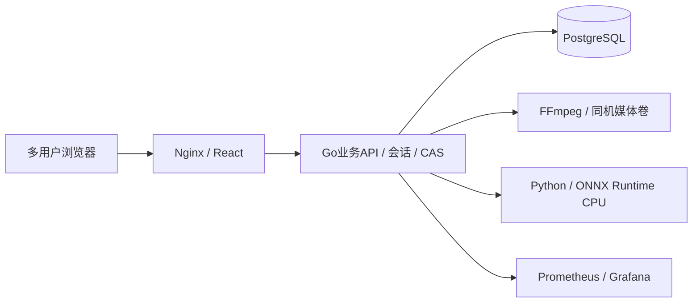

# P1同机部署、去隧道与迁移规格

版本：0.1.0｜待审核；只准备方案，未执行运维操作。

## 1. 唯一运行架构

全部服务属于同一台部署主机；云端和Mac运行相同Compose结构。不包含云端访问Mac的箭头，不部署relay/SSH反向隧道/端口转发/公网穿透。普通SSH仅用于云主机管理与上传部署包，不作应用依赖或媒体链路。

新媒体一律storageProvider=local，表示当前部署主机，不表示访问网页的用户电脑。来源标识维持public_sample/upload/dataset，新增local_directory替代远程Mac入口；legacy和mac枚举保留解读历史记录。前端只展示当前可用入口，公司API未配置仍准确显示未配置。所有正式帧JPEG进入管理卷中唯一不可变key目录；从同机只读来源导入副本，不能把宿主机可变化路径直接当正式frame。记录实际字节SHA/size，导出验证读取到的原图字节，缺失/变化时失败且不返回部分ZIP；有引用资源不被清理覆盖。ZIP在管理卷的私有暂存目录完整生成并验图/校验后才返回下载，不能先响应200再于末尾发现坏图。对旧无SHA的本地frame先在已验证备份/导入阶段补算并登记原字节摘要，再开放AI/新导出。

同机授权目录通过只读volume和配置允许的目录列表提供，返回不透明稳定sourceId而非物理路径；注册/import时校验文件哈希，禁止路径穿越/符号链接逃出白名单。上传到同机管理卷；公司API仍使用已观察schema、channel=4/play-url规则、API/媒体认证隔离与SSRF限制。Mac最终部署时API直接在内网访问。

云端开启上传仅供已邀请成员，限制500MiB/视频和单任务抽帧，界面提示仅上传授权示例；用户的“一段示例可验证”不是批量课堂授权。初始预置公开素材与已授权20秒视频，不额外抓取/下载课堂数据。

## 2. 明确退役范围

P1产品源码/运行配置不再注册远端Mac读取、注册、流式转发与ack恢复路径。移除SourceService.Bridge依赖、运行时APP_MAC_BRIDGE配置、compose.mac-bridge.yml/compose.sources.yml里的relay、远程媒体job/route和测试入口。共享provider类型保留mac以避免历史数据错误，不将其映射到本地路径。

Leader列出将删除/解耦的模块、调用者和测试迁移：`backend/internal/mediabridge/`、`mediaapi/`、`mediaagent/`、`cmd/media-agent/`、httpapi/source_mac.go与remote_*、exports/remote_*、前端MacSourcePanel、旧agent专属CI步骤。执行时先检查调用者，必要共用DTO/来源幂等逻辑留在业务包，不机械删整个目录破坏本机路径。

历史规格/审计保留，首页/启动说明明确“已退役”；不清理历史失败证据。旧mac provider记录只读不可用并返回REMOTE_STORAGE_RETIRED，不能执行自动cleanup或猜本地文件。没有实际文件及用户匹配决定，不迁移这些资源到local。

云端专用classroom-tunnel账号/key、classroom-mac-bridge-relay容器与相关Compose作为退役清单：启动P1后Leader核对归属、保留脱敏配置快照，关闭专用中继，撤销该账号forward权限/专用key。Windows同项目的SSH本地转发如仍运行也按PID/命令行核验归属后停止；无新增应用/监控转发链路。不得删除普通管理员SSH或媒体文件。Mac上的launchd/隧道需交给Mac执行者明确停止，Windows不能把“云端撤销”写成“Mac任务已卸载”；云端撤销后不依赖其是否继续重连。最终交接包包含去除旧任务说明，不要求今晚Mac在线。

## 3. PostgreSQL与历史数据

P1以已通过CI的PG候选为基础，不重写业务底座。权威生产数据源是仍在线P0的SQLite与匹配媒体卷，不能用候选测试PG替代。正式切换顺序：停止新任务→等待/记录终态→限制写入→一致SQLite备份+原媒体卷清单/哈希→在空目标PG用精确9fafbea工具迁移到schema4并确认→同版本只读导入工具→逐表/逐字段/关联/revision比对→P1版本migrator补00005起身份/AI迁移→回填bootstrap工作区→小范围只读/写入验证→开放业务。

现有migrate只有up/status，不支持target-version参数：必须从已校验9fafbea发布产物派生一次性工具镜像运行 `migrate up` / `migrate status`，其嵌入迁移只到4；不能先用P1镜像up全部迁移，再假定旧importer能插入新非空列。工具镜像SHA/二进制摘要、源SQLite快照哈希、目标空库记录和导入report写发布清单，之后才用P1镜像 `migrate up`。完整流程从真实旧schema fixture测试；无需为了本轮增加一个未经验证的target CLI。

导入命令为同版本 `import-sqlite /backup/P0.sqlite`，由外部受限env提供APP_DATABASE_URL，stdout仅脱敏导入report落外部文件；备份必须是已停止写入/一致备份的主库，不带活动-wal/-shm。验证report.backupSha256与备份清单一致、每表source/target count与canonicalSHA相等，再进入P1迁移。不得删除WAL来“完成备份”。

已执行迁移00001–00004不可改；P1新增00005起迁移，Leader统一命名/顺序，不让多个Agent抢迁移号。保存legacy本地storage_key、原ID、框与revision，不把合成验收库导入正式数据库。

已有PG容器不表示已有业务迁移。目标空库/版本、migrator与app角色权限、media volume身份都重新核对，拒绝用bootstrap脚本覆盖非空生产数据。模型权重/视频bytes不进入PG。

新写入前可退回原SQLite与原镜像；新写入后只允许兼容PG的代码回退或恢复匹配PG+媒体快照，不把新标注丢在SQLite回滚之外。用独立restore数据库验证pg_dump/restore与媒体关联，再记录生产备份位置；恢复实验不对当前可写实例执行覆盖。

## 4. 资源与HTTPS

2核4GB下建议上限：Go512MiB、PG512MiB、AI512MiB、Nginx64MiB、Prometheus256MiB、Grafana256MiB；实际总量/host余量同时观察。初始PG连接池5、AI单槽、FFmpeg单槽，不同时运行多套完整验收栈，GLM独立实例错峰且无授权课堂媒体。

所有新业务容器有限制/日志轮转10MiB×3，模型只读卷、运行数据在代码外。不用无限保留逐框debug/HTTP体日志；Prometheus标签不含userId/frameId/sourceId/具体文件名。指标包括推理耗时/失败/忙、审核决策计数、CAS冲突、DB与主机资源、未决风险，使用有限枚举；仪表盘不公开用户身份/素材。

公网仅Nginx80/443；PG/Python/监控无公网端口。申请公网IP短期TLS证书：Certbot>=5.4 webroot + shortlived profile，先验证challenge再用正式证书，Nginx显式安装/更新，云端设置证书续期与reload。获取失败不降为公开明文注册；报告阻塞。证书/密钥不进Git。

原公网Basic Auth overlay与账号会话的切换决策：旧实例继续保留Basic Auth；P1发布前在隔离公开实例验证会话/CSRF/API和媒体鉴权、退出失效及TLS，然后在同一已验证发布操作中用应用会话认证替换旧Basic overlay。新界面静态/注册登录可公开，真实媒体仍必须会话授权；禁止只删除Basic却未装好完整新认证。切换失败保持原带Basic的公网实例；进入PG新写入后只回退兼容PG且仍受保护的应用，不把认证或数据回退分开操作。

GLM隔离固定为**独立公开数据实例 + 独立QA数据库/媒体卷 + 临时测试账号**，不是当前共享生产工作区。为避免额外公网端口/隧道与同时多栈资源压力，可在正式切换前错峰把HTTPS入口指向该公开QA实例，测完关闭并再切正式实例；从不挂载真实课堂媒体、公司Key或生产凭证。QA数据库不会导入正式库。

Mac默认127.0.0.1单机访问；多人LAN访问显式配置绑定地址/可信Origin及受信任TLS。cloud证书不能复制当Mac地址证书使用。Compose不再全局强制linux/amd64，锁定基础镜像/依赖并构建amd64和arm64；ONNX Runtime arm64 wheel安装及真实模型加载需验证。未在真实Mac操作时标arm64构建/服务探针结果与Mac实机not_run两个状态。

## 5. 录屏与交付

云端示例完整操作注册/登录→抽帧→AI→风险定位/人工修正→保存→两账户冲突→完成→真实ZIP；录制2–4分钟默认公开视频、不含邀请码、密码、Token或公司身份。生成可播放文件、SHA和实际Git SHA索引，放runtime，不能说“准备录屏脚本”就是已录视频。

授权真实课堂只用于当前主机的模型/业务验证；若要把该画面放答辩/公开分享，需要对应许可。临时文件有保留清单，录屏后仅清理明确临时新增文件，旧媒体/标注不自动删除。

部署包包含 .env.example、镜像版本/模型SHA、初始化/迁移/启动/健康/备份/退出命令及macOS/Windows Docker前提。实际最终Mac部署由后续用户安排，不在本稿准备阶段安装Docker或远程改Mac。

依据：[Let's Encrypt IP证书与Certbot说明](https://letsencrypt.org/2026/03/11/shorter-certs-certbot)。申请成功及证书链验收仍是执行期门槛，不是文档浏览结论。
